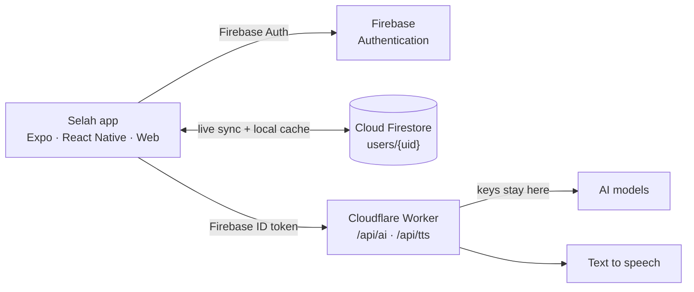

<div align="center">


# Selah

### The private AI journal that pauses with you.

*Write freely, or talk it through with a friend who notices and gets to know you.*

<br />


[Overview](#overview) &nbsp;·&nbsp; [Features](#features) &nbsp;·&nbsp; [Using Selah](#using-selah) &nbsp;·&nbsp; [How the AI works](#how-the-ai-works) &nbsp;·&nbsp; [Privacy](#privacy-and-your-data) &nbsp;·&nbsp; [Architecture](#architecture) &nbsp;·&nbsp; [Setup](#setup)

</div>

<br />

> **Selah** (סלה) is a Hebrew word from the Psalms and Habakkuk, usually read as a call to *pause and consider what was just said.* To intentionally take time to reflect.

---

## Overview

Selah is a private journal with an AI companion. You write reflections, talk things through with a friend who gets to know you, and see your own patterns over time. It runs in the browser today, with iPhone and Android apps built from the same codebase.

<table>
<tr>
<td width="25%" valign="top">

**Reflect**<br />
A blank page. No save button, no formatting, no streaks. Dictate, add a photo, leave whenever you like.

</td>
<td width="25%" valign="top">

**Talk**<br />
A friend who is always there to listen. With *Just listen* on, they never try to fix anything.

</td>
<td width="25%" valign="top">

**Notice**<br />
A friend who pays attention to your mood and writing, and helps you see patterns over weeks and months.

</td>
<td width="25%" valign="top">

**Remember**<br />
A friend who remembers. You can see every memory, correct it, and delete it whenever you like.

</td>
</tr>
</table>

| | |
|---|---|
| **Product** | A private journal with an AI companion |
| **Platforms** | Web (live) · iOS and Android (same codebase, dev builds) |
| **Sign-in** | Passwordless email link via Firebase Authentication |
| **Data** | Cloud Firestore under each user's own account, cached on the device |
| **AI** | Third-party models reached only through a small backend proxy that holds the keys |
| **Voice** | Dictation (device speech recognition) and spoken replies (cloud voice, device voice as fallback) |
| **Data policy** | Nothing sold, no ads, no third-party analytics |
| **Not** | A therapist, a medical service or a crisis line |

---

## Why Selah exists

Most journaling apps are either a plain notebook (private, but silent) or a generic chatbot (responsive, but it forgets you and talks like a customer-service script). Selah combines the two. The journal stays quiet and yours, and the companion carries what it has learned about you from one conversation to the next, so you never have to re-explain your life.

### Design principles

| Principle | What it means in the app |
|---|---|
| **Pause, don't pressure** | No streaks, no daily goals, no guilt. Milestones are counted facts ("50 reflections"), never cheering. |
| **Sound like a friend** | Short single-paragraph replies. No lists, bold, em dashes or stock validation, and it never narrates its own memory ("I remember you said..."). |
| **Listen before fixing** | A per-chat *Just listen* switch means no advice at all. The chat background turns a calmer blue while it is on. |
| **Your words stay yours** | The Feed quotes only your own writing. Generated text is never mixed into what you wrote. |
| **Transparent memory** | Everything Selah learns is visible in Settings. Correct it, delete it, export it. Deleted memories are not learned again. |
| **Gentle by default** | Anything shown unprompted is filtered so it never resurfaces grief, illness or crisis. The companion can still talk about anything *you* bring up. |
| **Safety first** | A local screen plus the model's judgment watch for crisis language and show a quiet support card (988 in the US). |
| **Low-cost AI** | Learning is batched into one background call, prompts are generated at most once a day, and stats are computed on the device. |

---

## Features

Three tabs (**Today**, **Journal**, **Feed**), a settings area and a public landing page.

<details open>
<summary><b>Writing</b></summary>
<br />

- **Autosaves** about 0.7 seconds after you stop typing, with a small *Writing... / Saved* label. There is no Save button.
- **Optional title**, taken from your first line if you leave it blank.
- **Photos** can be attached; the files stay on the device.
- **Dictate** with the mic button (iOS, Android, and Chrome or Safari on the web).
- **Start from a prompt.** The prompt appears in a quiet block above the page and is stored separately, so it is never part of the text you wrote.
- **Talk about it** turns an entry into a chat, with the entry as context.

</details>

<details open>
<summary><b>Talking</b></summary>
<br />

- **Streaming replies** that type in as they are generated, and a short batching wait so several quick messages get one reply.
- **Just listen mode**, saved per chat.
- **Hands-free voice chat** (listen, think, speak, repeat) with a natural cloud voice and a device-voice fallback.
- **Rename a chat** by tapping its title. Names you choose are never replaced by the automatic title.
- **Support card** that appears, quietly and dismissibly, when a conversation shows real risk.
- A plain, friendly notice (never saved as a message) if the AI is busy, offline or at its daily limit.

</details>

<details open>
<summary><b>Today</b></summary>
<br />

- Greeting, **Write it down** and **Talk it through**.
- One-tap **mood check-in** (Rough, Low, Okay, Good, Great) with custom line-drawn faces.
- **Pick up where you left off**: your latest entry or chat from the last four days, only if it passes the gentleness filter.
- **Picking up on**: personal chat and journal starters, each dismissible, with an *All prompts* screen.

</details>

<details open>
<summary><b>Journal</b></summary>
<br />

- Everything you have written, newest first, with **All / Reflections / Chats** filters.
- **Search** across titles, entries and every message in every chat.
- **Pin** up to 5 favorites at the top. Pinning a sixth offers to swap out the oldest.
- **Delete with undo.** Swipe on phones (left to delete, right to pin); on desktop, a button appears on hover.

</details>

<details open>
<summary><b>Feed</b></summary>
<br />

A calm daily feed built only from your own material.

- **Quote cards**: short lines from your own writing. Keep one to save it to **Keepsakes** (up to 500).
- **On this day**: entries from about a month or a year ago.
- **Weekly note** and **themes**: how the week felt. No card is made at all for a week with crisis language.
- **Milestones**: 35 counted facts, at most one a day.

</details>

<details>
<summary><b>What Selah learns</b></summary>
<br />

- **What Selah remembers**: up to 120 short memories, each viewable and deletable.
- **Personality notes**: a private portrait in eight sections (what drives you, emotional landscape, patterns under pressure, how you relate, how you think, what helps and what backfires, tensions, right now). You can confirm or correct every claim.
- **Import from another AI**: paste a ready-made prompt into ChatGPT, Claude or Gemini, then paste the answer back so Selah starts out knowing you.
- **Your trends**: a free on-device weekly recap, a mood chart, and on-demand monthly insights.

</details>

<details>
<summary><b>Settings, account and polish</b></summary>
<br />

- Profile, appearance (match device, light, dark), optional daily **check-in** notifications (phone app), and **Privacy cover** that hides the screen when you look away.
- **Change email**, **export everything** (JSON), and **delete your account**.
- Light and dark themes in a soft sage, rose and sky palette, **Newsreader** headings, an animated gradient background that respects reduced motion, a floating glass tab bar, swipe navigation, haptics, and a custom SVG icon set.
- A public landing page, privacy policy, structured data, sitemap and PWA manifest.

</details>

---

## Using Selah

You can be writing within a minute.

1. **Sign in.** Enter your email and open the link we send. On the web it signs you in right away; on a phone it opens the web page first, then offers an *Open in the app* button. There are no passwords to create or lose.
2. **Answer four questions.** What to call you and your pronouns, what you like to do, a bit about life right now, and what brings you here.
3. **Check in and write.** Tap a mood face on **Today**, then **Write it down**. Stop whenever you like; it saves itself.
4. **Talk it through.** Tap **Talk about it** under an entry, or **Talk it through** on Today. Turn on **Just listen** when you only want to be heard.

<details>
<summary><b>Everyday cheat sheet</b></summary>
<br />

| I want to... | Do this |
|---|---|
| Write freely | Today, *Write it down* (or tap a Write prompt) |
| Think out loud | Today, *Talk it through*, or tap a Talk prompt |
| Vent without advice | Open a chat and switch on *Just listen* |
| Speak instead of type | Tap the mic to dictate, or start voice chat |
| Find something old | Journal tab: search any word, or filter to Reflections or Chats |
| Keep something handy | Pin it (up to 5), or keep a Feed quote as a keepsake |
| Rename a chat | Open it and tap its title |
| See what Selah knows | Settings, Personalization, *What Selah remembers* |
| Fix a wrong memory | Delete it, or correct the claim in *Personality notes* |
| Be known from day one | Settings, *Import from another AI* |
| See how I've been | Settings, *Your trends* |
| Get a gentle nudge | Settings, *Check-ins* (phone app) |
| Hide my screen | Settings, Privacy, *Privacy cover* |
| Take my data with me | Settings, Email and account, *Export your data* |
| Erase everything | Settings, Email and account, *Delete my account* |

</details>

> [!IMPORTANT]
> **Selah is a reflection tool, not therapy or a crisis service.** If a conversation shows real risk, a support card appears with the 988 line (United States). If you are in immediate danger, call 911 or your local emergency number. Hotlines worldwide: [findahelpline.com](https://findahelpline.com).

---

## How the AI works

Selah's AI does five jobs, each a separate small, rate-limited call: **reply in chat**, **learn from what you write**, **suggest prompts**, **write the Feed's weekly cards**, and **build a private portrait**.

### Chat replies

Every reply is built from a layered system prompt: persona, strict writing rules, "read the moment" rules (ordinary news is not treated as distress), rules for using what it knows without reciting it, your name and pronouns, your memories, recent entries and chat topics, your personality notes, and a few of your recent messages as voice samples. A `cleanReply()` pass enforces the mechanical rules (dashes, line breaks, markdown) as a backstop. Replies stream over XHR/SSE so the same code works on web and native.

### Learning memories

Selah learns only from **your own words**, never from its replies.

| Step | Behavior |
|---|---|
| **Queue** | After each AI reply, and when you pause in a reflection (100+ characters, 80+ new), material is queued. |
| **Send** | One combined call after 30 s of quiet, 4 min at most, at 4,000 characters, or when the app is backgrounded. |
| **Close the tab** | The queue is saved to the device and flushed when the tab is hidden; anything unfinished is learned on next open. |
| **Result** | The model returns structured JSON: an updated list of up to 120 short memories (merged, deduplicated, dated). A guard rejects any reply that shrinks the list by more than 5. |
| **Forgotten** | Memories you delete go on a *forgotten* list and are not learned again. |

### Personality notes

A separate analysis reads the whole picture (journal, your chat messages, memories, writing statistics, imported text) and builds an **eight-section model**. Every claim carries a confidence level and needs evidence. It updates the previous model instead of restarting, treats your *"not me"* and *"spot on"* feedback as ground truth, and only re-runs when enough new writing has built up and at least six hours have passed.

### The gentleness filter

`lib/painful.js` decides whether something is too heavy to bring up unprompted. It first blanks everyday phrases that only *look* painful ("dying to try", "my phone died", "death metal", "kill the server"), then scores what remains as **severe**, **moderate** or **mild**, respecting negation ("not stressed"). It guards the daily prompts, the Feed, the weekly cards and "pick up where you left off". The companion itself still sees everything, so it can respond fully to whatever you bring up.

### Safety

`lib/safety.js` runs a quick local screen at two levels, **high** (a stated plan, means or timing) and **concern** (self-harm language without a plan). It never decides on its own: it tells the companion to pay closer attention, the model judges idioms like *"this traffic is killing me"*, and a hidden marker is added only for genuine risk. A quiet support card then appears under that reply.

### Limits and errors

The backend keeps each account to a daily AI allowance. When a limit is reached, or the AI is busy or offline, the app shows a plain notice and keeps working. The journal, search, pins and export never depend on the AI.

---

## Privacy and your data

What you write is stored under your own account, only you can read it, nothing is sold, and there are no ads.

| | |
|---|---|
| **Sign-in** | Passwordless email link. Selah never stores a password. |
| **Stored** | Email, name and setup answers; reflections and chats; memories, style, personality notes, insights and prompts; mood check-ins; preferences. |
| **Photos** | Stay on the device (only a reference is stored), so they do not sync or export. |
| **Where** | Google Firebase (Authentication and Cloud Firestore), with rules limiting each account to its own data. A local cache is cleared on sign-out or account deletion. |
| **AI** | Relevant text is sent through Selah's backend to AI model providers when you chat, write or ask for insights. |
| **Voice** | Dictation uses your device or browser; Selah receives only the text. Spoken replies come from a cloud voice via the backend. |
| **Tracking** | No ads, no third-party analytics, no tracking scripts or advertising cookies. |
| **Sharing** | Never shown to other people. No public profile. |

**Your controls.** See, correct and delete what Selah remembers; export everything as a file; change your email; or delete your account, which erases entries, chats, profile and the local cache.

---

## Architecture

One JavaScript codebase (Expo and React Native, with React Native Web for the browser) talks to Firebase for accounts and storage, and to a small Cloudflare Worker for everything that needs a secret key.



| Layer | Choice | Notes |
|---|---|---|
| App framework | Expo, React Native, Expo Router | File-based routes under `app/`; JSX, no TypeScript |
| Web | React Native Web, static export | `npm run build:web` also writes `sitemap.xml` |
| Accounts | Firebase Authentication | Email-link (passwordless) sign-in |
| Storage | Cloud Firestore | Live sync with `onSnapshot`; AsyncStorage cache |
| AI and voice backend | Cloudflare Worker | Holds keys, verifies the Firebase ID token, enforces daily allowances |
| AI models | Third-party providers behind the Worker | Provider-agnostic; chosen server-side |
| Text to speech | Fish Audio via the Worker | Sentence by sentence; device voice fallback |
| Dictation | `expo-speech-recognition` | Native module; needs a dev build |
| Motion and gestures | Reanimated, Gesture Handler, expo-blur, expo-linear-gradient | Glass tab bar, swipe nav, animated background |
| Icons and fonts | `react-native-svg` (custom `Icon`, `MoodFace`), Newsreader | |

### State and data flow

All state lives in React context providers: `AuthContext`, `StoreContext`, `ThemeContext`, `ToastContext`, `DevModeContext` and `PrivacyCoverContext`. **`StoreContext` is the center of the app**: it subscribes to Firestore, mirrors data to a local cache, queues learning, and generates prompts and weekly cards. The route guard in `app/_layout.jsx` sends signed-out people to sign-in, signed-in people without a profile to onboarding, and everyone else into the tabs.

### Firestore data model

| Path | Holds |
|---|---|
| `users/{uid}` | Profile: name, pronouns, memories, forgotten list, personality model, mood log, keepsakes, daily prompts, weekly cards, insights, preferences |
| `users/{uid}/entries/{id}` | A reflection: title, content, image references, prompt, date, `editedAt`, `pinnedAt` |
| `users/{uid}/chats/{id}` | A chat: title, `titled`, messages, `listenMode`, date, `pinnedAt` |

<details>
<summary><b>Project structure</b></summary>
<br />

```
src/
├── app/                 Screens and routes (Expo Router)
│   ├── index.jsx        Public landing page on web; signed-in people go to Today
│   ├── (tabs)/          today · journal · feed
│   ├── editor/          new and existing reflections
│   ├── chat/[id].jsx    Streaming chat, Just listen, voice chat, rename
│   ├── settings/        account · memories · personality · import · trends
│   ├── auth/            email · check-email · finish-email
│   ├── onboarding.jsx   Four-step setup
│   ├── privacy.jsx      Privacy policy
│   ├── +html.jsx        Web HTML shell, splash and site-wide SEO
│   └── +not-found.jsx   404
├── components/          Reusable UI (editor, composer, mood faces, icons, glass tab bar, landing page)
├── context/             Auth, Store (the heart of the app), Theme, Toast, DevMode, PrivacyCover
├── lib/                 Logic with no UI
│   ├── ai.js            Every AI call and its prompts
│   ├── painful.js       Gentleness filter
│   ├── safety.js        Crisis-language screen
│   ├── feed.js          Feed building and quote rules
│   ├── milestones.js    The 35 milestones
│   └── ...              titles, mood, writing stats, voice, export, notifications
├── firebase.js
└── theme.js             Colors, radii, spacing, heading fonts
```

</details>

---

## Setup

You need a Firebase project, the AI and voice Worker deployed, a `.env` file and the dependencies below. Web works in a normal browser; native features (dictation, scheduled notifications, reliable gestures) need a **development build** rather than Expo Go.

### 1. Firebase

1. Create a Firebase project.
2. Under **Authentication → Sign-in method → Email/Password**, turn on **Email link (passwordless sign-in)**.
3. Create a **Cloud Firestore** database (the free Spark plan is enough).
4. Add rules so each person can only reach their own data:

```
rules_version = '2';
service cloud.firestore {
  match /databases/{database}/documents {
    match /users/{uid}/{document=**} {
      allow read, write: if request.auth != null && request.auth.uid == uid;
    }
  }
}
```

### 2. Backend proxy (AI and voice)

The app never holds AI or voice keys. Deploy the Cloudflare Worker described in `CLOUDFLARE.md`. It exposes `/api/ai` and `/api/tts`, verifies the Firebase token on every request, and enforces each account's daily allowance.

### 3. Environment variables

Create `.env` (and `.env.development` / `.env.production` for the API address). `EXPO_PUBLIC_` variables are inlined into the client, which is fine for Firebase's public client config.

| Variable | Purpose |
|---|---|
| `EXPO_PUBLIC_FIREBASE_API_KEY`, `..._AUTH_DOMAIN`, `..._PROJECT_ID`, `..._STORAGE_BUCKET`, `..._SENDER_ID`, `..._APP_ID` | Firebase web app config |
| `EXPO_PUBLIC_EMAIL_LINK_WEB_URL` | Where the emailed sign-in link lands, e.g. `https://your-site/auth/finish-email` |
| `EXPO_PUBLIC_API_BASE_URL` | Address of the Cloudflare Worker |
| `EXPO_PUBLIC_SITE_URL` | The real public address, no trailing slash (canonical links, share images, sitemap) |
| `EXPO_PUBLIC_CONTACT_EMAIL` | Optional contact line on the privacy page |

### 4. Install and run

```bash
npx expo install firebase expo-linking @react-native-async-storage/async-storage \
  react-native-gesture-handler react-native-reanimated react-native-safe-area-context \
  expo-blur expo-linear-gradient expo-font @expo-google-fonts/newsreader expo-status-bar \
  expo-haptics expo-image-picker expo-notifications expo-file-system expo-sharing \
  expo-speech expo-audio expo-speech-recognition react-native-svg

npx expo start          # web, Expo Go or a dev client
npm run build:web       # static web build + sitemap
```

In `babel.config.js`, list `react-native-reanimated/plugin` **last** in `plugins`. In `app.json`, set `"scheme": "selah"` (it must match the `selah://` link in `finish-email.jsx`). Use a development build (`eas build --profile development`, or `expo run:ios` / `run:android`) to test dictation, notifications and the native sign-in hand-off.

### Where to change things

| To change... | Look in |
|---|---|
| The companion's tone and rules | `buildSystemPrompt` in `lib/ai.js` |
| What counts as too heavy to resurface | Tiers in `lib/painful.js` (test against real sentences before shipping) |
| Feed quote rules, On this day slack | `lib/feed.js` |
| Milestones | Tables at the top of `lib/milestones.js` |
| Learning timing | `LEARN` constants in `context/StoreContext.jsx` |
| Pin limit, web width | `MAX_PINS` in `app/(tabs)/journal.jsx`, `APP_MAX_WIDTH` in `app/_layout.jsx` |
| Colors, radii, fonts | `theme.js` |

---

## Known limitations and roadmap

<details>
<summary><b>Known limitations</b></summary>
<br />

- **Native sign-in takes one extra tap.** Firebase links must be real `https://` addresses, so on a phone the link opens the web page first. A seamless hand-off needs iOS Universal Links and Android App Links on your own domain.
- **"Liquid Glass" is an approximation.** The tab bar uses blur, a highlight and a spring-animated pill, not Apple's private material.
- **Closing a tab mid-conversation delays learning** until the next open; an AI call cannot finish after the page is gone.
- **The gentleness filter is keyword-based.** It is tuned and tested but errs toward leaving things out.
- **Photos do not sync or export.** Only references are stored.
- **Check-in notifications and dictation are native only** and need a development build.
- **AI is allowance-limited.** The journal keeps working when AI does not.
- **No streaks, by design.**

</details>

<details>
<summary><b>Roadmap ideas</b></summary>
<br />

- Ship the iPhone and Android apps with sync across devices, plus Universal Links and App Links.
- Sync photos by uploading them to storage, and include them in export.
- Mark memories as sensitive when written, so the filter can use a stored flag.
- A "forget the last hour" control and a setting for how much the companion remembers.
- Automated tests for `lib/painful.js`, `lib/titles.js` and the learning queue.
- An exportable yearly look-back built from keepsakes and milestones.

</details>

---

<div align="center">

<sub>Selah is a reflection tool, not a therapist, a medical service or a crisis line.<br />If you are in the United States and in crisis, call or text <b>988</b>.</sub>

<br />

<sub>Built with care. Take a minute.</sub>

</div>
